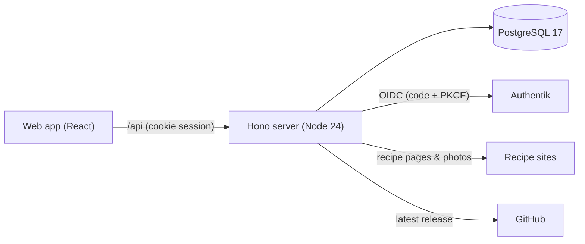

<div align="center">
  
  <h1>Cooking</h1>
  <p>A self-hosted household cookbook: import recipes from recipe sites, YouTube, Instagram or TikTok videos, or any text, and cook from a clear, scalable page.</p>

  
  
  
  
  
</div>

## ⚠️ • Disclaimer

A personal project, built for one household. It works, but expect sharp edges.

## 📖 • Table of Contents

- [Overview](#-•-overview)
- [Importing recipes](#-•-importing-recipes)
- [Components](#-•-components)
- [Tech Stack](#-•-tech-stack)
- [Getting Started](#-•-getting-started)
- [Sign-in & Security](#-•-sign-in--security)
- [Keyboard Shortcuts](#-•-keyboard-shortcuts)
- [Health Check](#-•-health-check)
- [Project Structure](#-•-project-structure)
- [Docker Deployment](#-•-docker-deployment)
- [Credits](#-•-credits)
- [License](#-•-license)

## 🍲 • Overview

One cookbook shared by everyone who signs in: recipes are visible to the whole household,
editable by whoever added them (and admins), while favourites, ratings and "I cooked it" marks
are personal.

- **Import from anywhere**: a recipe site's link, a video (YouTube, TikTok, Instagram: the recipe is in the caption), or pasted text. Check the draft, save. The photo is copied to the server.
- **Share**: send a recipe to someone in the household with a note (it lands in their "Shared with me", with a count of new ones), or turn on a public link (`/s/<token>`) that shows it read-only to anyone, without an account, until you turn it off.
- **Several sources per recipe**: the blog, the video it comes from, "Grandma's notebook", each with its icon; filter the cookbook by source.
- **Cook from it**: servings stepper that rescales quantities (`200 g` → `250 g`, `½` → `¾`), tick off ingredients and steps, the screen stays on.
- **Plan recipes**: "Plan" on a recipe puts it on a day and a meal, with a note; the recipe lists your planned dates, to change or remove. Plans are private: nobody else sees yours. Claude can plan recipes too.
- **Equipment**: tick what a recipe needs (oven, blender, stand mixer, airfryer, Thermomix…; imports guess it from the steps), then filter "with" or "without" it ("sans four").
- **Photos**: choose a file, paste one (button or `Ctrl+V` in the editor) or drop it on the photo.
- **Find it again**: categories, tags, cuisines, "ready in under 30 min", favourites, "not cooked yet", and a `Ctrl+K` search that also looks inside ingredients ("poireaux").
- **Same shell as the siblings** ([calendar](https://github.com/PaulBayfield/calendar.bayfield.dev), [music](https://github.com/PaulBayfield/music.bayfield.dev), [DevTime](https://github.com/PaulBayfield/dev.bayfield.dev)): same header, sidebar, side panel, settings, five themes, English/French and update check.

## 🔗 • Importing recipes

**Recipe sites.** Nearly every recipe site publishes its recipes as [schema.org/Recipe](https://schema.org/Recipe)
data for search engines (JSON-LD, sometimes microdata). The server fetches the page and reads
that: title, photo, servings, times, ingredients, steps (with sections), category, cuisine,
keywords, author. No per-site scraper to maintain. Tested on Marmiton, 750g and BBC Good Food.
When that data lacks the ingredients or the steps (or the page has none), the page's own text is
read like a caption, between its "Ingrédients"/"Préparation" headings and its comments. Sites that
turn the server away (bot protection) get a clear message instead: the **bookmarklet** then reads the
recipe data on the page in your own browser and hands it over.

**Videos and text.** Video recipes live in the caption. YouTube publishes the full description with the page,
so a link is enough. Instagram (and often TikTok/Facebook) only show captions to signed-in visitors: the
import then asks for the text, which you paste, or which the **bookmarklet** reads from the video page in
your own browser and passes along in the URL fragment (never sent to a server). A caption parser
(`server/src/caption.ts`) finds the ingredient and step sections ("Ingrédients", bullets, `1.`/`1️⃣`/`Étape 1`,
"Pour la pâte :" sub-headings), servings and times, turns hashtags into tags and drops the "follow me / link in bio" outro,
chapters, separators, shop and book links, and credits. A description that only links to the recipe ("Recette complète :
https://…") is followed: the linked page is read, with the video kept as a second source.
The server never impersonates a crawler to get around a site's sign-in wall.

**The template.** Text written in the recipe template (Markdown with a front matter: `title`, `category`, `cuisine`,
`tags`, `servings`, `prep_time`, `cook_time`, `author`, `source`, then `## Ingrédients` / `## Préparation` with `###`
sub-sections and `## Notes`) fills every field, nothing guessed (`server/src/template.ts`). The text tab of the import
dialog fills it in for you, or copies a prompt to give an AI with a recipe: paste its answer back.

**Claude (MCP).** `/mcp` is an [MCP](https://modelcontextprotocol.io) server (streamable HTTP, stateless) so Claude can
search the cookbook, read recipes, import from a link or text and add or change recipes while you chat. Each person
creates an access token in Settings → Claude, which shows the connector address for Claude.ai / Claude Desktop
(`https://cooking.example.com/mcp/<token>`) and the Claude Code command (`Authorization: Bearer <token>` header).
Recipes are added in that person's name; only the token's SHA-256 is stored.

Ways in: the **Import** button (`I`, link or text), **pasting a link or a recipe's text** anywhere in the app, the
**bookmarklet** from Settings → Data (one click from the recipe page or video), or **Claude**.

The fetch refuses private and local addresses (no reaching the host's network through it),
non-standard ports and credentials in URLs, re-checks every redirect, caps pages at 4 MB and
photos at `IMAGE_MAX_MB`, and only keeps photos whose bytes are really JPEG/PNG/WebP/GIF/AVIF.

## 🧩 • Components



| Component | Role |
|---|---|
| `src/` | The web app: shell (sidebar, toolbar, side panel, settings, search) and the recipe views |
| `server/src/api.ts` | Recipes, favourites, ratings, export, sessions, admin |
| `server/src/importer.ts` | Safe fetching, schema.org Recipe extraction, video descriptions |
| `server/src/caption.ts` | Captions and free text to ingredients and steps; source kinds |
| `server/src/auth.ts` | Sessions and Authentik/OIDC sign-in |
| PostgreSQL | Everything, photos included (`recipe_images`) |

## 🛠️ • Tech Stack

| Layer | Choice |
|---|---|
| Front end | React 19, TypeScript 7, Vite 8 |
| Server | Node 24 running `.ts` directly, Hono 4 |
| Database | PostgreSQL 17 (postgres.js), embedded-postgres for development |
| Auth | OIDC with Authentik, no app passwords |
| Container | One image on `ghcr.io/lucascrmt/cooking` |

## 🚀 • Getting Started

### Prerequisites

Node 24+. Docker only for deployment.

### Installation

```sh
npm install && npm --prefix server install
cp server/.env.example server/.env
```

### Environment Variables

Set in `server/.env` (documented in `server/.env.example`):

| Variable | Required | Description |
|---|---|---|
| `PUBLIC_URL` | yes | Where the app is reachable (OIDC redirect) |
| `DATABASE_URL` | yes | PostgreSQL connection string |
| `OIDC_ISSUER`, `OIDC_CLIENT_ID`, `OIDC_CLIENT_SECRET` | yes* | Authentik provider (*not needed with `DEV_LOGIN_USER` on localhost) |
| `OIDC_NAME` | no | Sign-in button label (default `Authentik`) |
| `OIDC_AUTO_CREATE` | no | Create accounts on first sign-in (default `true`) |
| `OIDC_ALLOWED_GROUPS` / `OIDC_ADMIN_GROUPS` | no | Group-based access and admin rights |
| `DEV_LOGIN_USER` | no | Development sign-in, honoured only on `http://localhost` |
| `IMPORT_ENABLED` | no | Turn the importer off (`false`) |
| `IMAGE_MAX_MB` | no | Largest photo kept (default 8) |
| `CLIENT_IP_HEADER` | no | Visitor IP header behind a proxy (rate limits) |
| `UPDATE_CHECK` | no | Look for new releases on GitHub (default `true`) |

### Running Locally

```sh
npm --prefix server run db:dev      # embedded Postgres on :5434 (keep it running)
npm --prefix server run seed        # 8 demo recipes for user "demo"
npm run server                      # API on :8792 (DEV_LOGIN_USER=demo in server/.env)
npm run dev                         # web on :1450, proxying /api
```

Or serve the built app from the server alone: `npm run build`, then `npm --prefix server start` and open http://localhost:8792.

## 🔐 • Sign-in & Security

- Authentik: *Applications → Providers → OAuth2/OpenID Provider*, client type **Confidential**,
  redirect URI `https://<your host>/api/auth/oidc/callback`, scopes `openid profile email`
  (add a `groups` mapping for `OIDC_ALLOWED_GROUPS` / `OIDC_ADMIN_GROUPS`). Then create an
  Application using it and copy its issuer, client ID and secret into `server/.env`.
- The first account becomes admin. Sessions are random tokens stored hashed, in an `HttpOnly`,
  `SameSite=Lax`, `__Host-` cookie; cookie-authenticated writes must come from the app's own origin.
- Strict CSP: only the app's own origin (photos are served by the app), the inline theme script allowed by hash.

## ⌨️ • Keyboard Shortcuts

| Keys | Action |
|---|---|
| `Ctrl+K` or `/` | Search |
| `I` | Import a recipe |
| `N` | New recipe |
| `E` / `F` | Edit / favourite the open recipe |
| `Ctrl+B` or `\` | Toggle sidebar |
| `.` | Toggle side panel |
| `Ctrl+,` | Settings |
| `Ctrl+Enter` | Save in the editor |
| `Esc` | Close / cancel |

## ❤️ • Health Check

`GET /api/health` answers `{"ok":true}` when the database is reachable (used by the Docker `HEALTHCHECK`).

## 📁 • Project Structure

```
src/                 React app (components/, lib/, styles.css shared shell, recipes.css)
server/src/          index.ts, config.ts, db.ts, auth.ts, http.ts, api.ts, importer.ts, updates.ts
server/scripts/      dev-db.ts (embedded Postgres), seed.ts (demo recipes)
.github/workflows/   ci.yml, deployment.yaml
```

## 🐳 • Docker Deployment

```sh
cp .env.example .env                  # POSTGRES_PASSWORD (openssl rand -base64 24)
cp server/.env.example server/.env    # PUBLIC_URL, OIDC_*
docker compose up -d
```

Put it behind your reverse proxy: `https://cooking.example.com → localhost:8792`.

## 🙏 • Credits

By [LucasCrmt](https://github.com/LucasCrmt), built on the shared shell of [Paul Bayfield](https://github.com/PaulBayfield)'s bayfield.dev apps.

| Dependency | Use |
|---|---|
| [React](https://react.dev) | UI |
| [Vite](https://vite.dev) | Build |
| [Hono](https://hono.dev) | Server |
| [postgres.js](https://github.com/porsager/postgres) | Database client |
| [embedded-postgres](https://github.com/leinelissen/embedded-postgres) | Local database |
| [Lucide](https://lucide.dev) | Icons |

## 📜 • License

Copyright (C) 2026 LucasCrmt
Based on the bayfield.dev apps, Copyright (C) 2026 Paul Bayfield

This program is free software: you can redistribute it and/or modify it under the terms of the
GNU Affero General Public License as published by the Free Software Foundation, either version 3
of the License, or (at your option) any later version.

This program is distributed in the hope that it will be useful, but WITHOUT ANY WARRANTY; without
even the implied warranty of MERCHANTABILITY or FITNESS FOR A PARTICULAR PURPOSE. See the GNU
Affero General Public License for more details.

You should have received a copy of the GNU Affero General Public License along with this program.
If not, see <https://www.gnu.org/licenses/>.
